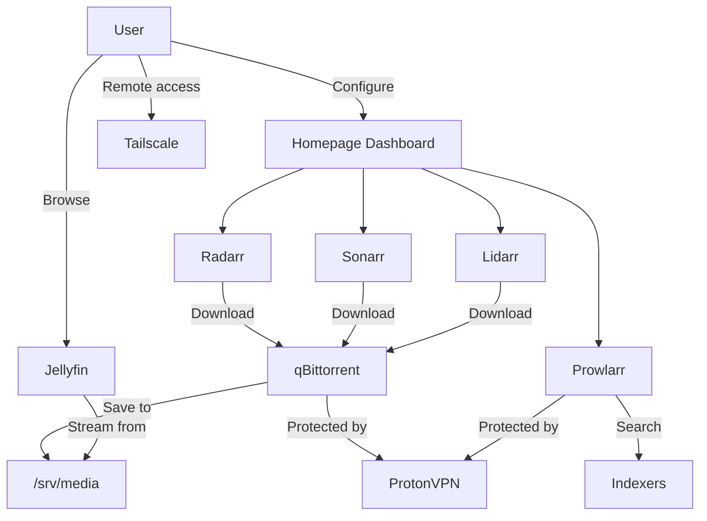

<div align="center">

# Homemade Media Server

**A self-hosted media server stack with VPN-protected downloads**

[](https://www.docker.com/)
[](https://jellyfin.org/)
[](https://protonvpn.com/)
[](https://tailscale.com/)

**[Quick Start](#quick-start)** · **[Configuration](CONFIGURATION.md)** · **[Troubleshooting](#troubleshooting)**

</div>

---

## Table of Contents

- [Overview](#overview)
- [Prerequisites](#prerequisites)
- [Quick Start](#quick-start)
- [Services](#services)
- [Storage](#storage)
- [Startup Order](#startup-order)
- [Configuration](#configuration)
- [Management](#management)
- [Remote Access](#remote-access)
- [Architecture](#architecture)
- [Troubleshooting](#troubleshooting)
- [Resources](#resources)

## Overview

This project provides a fully self-hosted media server with automated downloads and VPN protection.

**Media management**
- Jellyfin - stream movies, TV shows and music
- Radarr - automatic movie management
- Sonarr - automatic TV show management
- Lidarr - automatic music management
- Whisparr - adult content manager
- Bazarr - automatic subtitle download

**Downloads and tools**
- qBittorrent, routed through ProtonVPN
- Prowlarr - indexer manager
- Sabnzbd - usenet client
- FlareSolverr - Cloudflare bypass
- Homepage - unified dashboard
- Portainer - Docker management
- Tailscale - secure remote access

**[Back to top](#table-of-contents)**

---

## Prerequisites

- OS: Linux (Debian/Ubuntu recommended)
- Storage: one disk/partition per library you want to keep (Films, Series, Music)
- A ProtonVPN account ([sign up](https://protonvpn.com/))
- A Tailscale account ([sign up](https://tailscale.com/)) - required, used for all remote access

**[Back to top](#table-of-contents)**

---

## Quick Start

> Setup time: about 15 minutes, most of it automated.

### 1. Clone the repository

```bash
git clone <your-repo>
cd netflix
```

### 2. Run the installer

```bash
./scripts/install.sh
```

The installer is interactive and idempotent - it can be re-run safely at any time; anything already configured is detected and skipped. It walks through:

1. System packages (Docker, OpenSSH, Tailscale, utilities)
2. Tailscale login (required)
3. Storage assignment for Films / Series / Music (see [Storage](#storage))
4. Shared configuration (`media/.env`) and ProtonVPN credentials
5. Docker network creation
6. Boot-time startup service (`systemd`)
7. First start of the full stack, with health checks

### 3. Configure the services

```bash
./scripts/configure-services.sh
```

This second script configures Radarr/Sonarr/Lidarr/Whisparr (root folders, renaming, qBittorrent as the download client), qBittorrent (categories, paths) and Prowlarr (FlareSolverr proxy, app sync) entirely through their REST APIs — no manual clicking required. It will ask for your qBittorrent WebUI credentials. See [AUTOMATION.md](AUTOMATION.md) for exactly what it does and [CONFIGURATION.md](CONFIGURATION.md) for the handful of steps that still need a human (adding indexers, Jellyfin libraries).

### 4. Access your services

The installer prints every service URL at the end, and `./media-server.sh urls` shows them again at any time.

**Next**: [Configure your services](CONFIGURATION.md)

**[Back to top](#table-of-contents)**

---

## Services

| Service      | Port  | URL                          | Description        |
|--------------|-------|-------------------------------|---------------------|
| Homepage     | 3000  | http://SERVER_IP:3000        | Dashboard           |
| Portainer    | 9000  | http://SERVER_IP:9000        | Docker UI           |
| Jellyfin     | 8096  | http://SERVER_IP:8096        | Media server        |
| qBittorrent  | 49893 | http://SERVER_IP:49893       | Torrent client       |
| Prowlarr     | 9696  | http://SERVER_IP:9696        | Indexer manager      |
| Radarr       | 7878  | http://SERVER_IP:7878        | Movies              |
| Sonarr       | 8989  | http://SERVER_IP:8989        | TV shows            |
| Lidarr       | 8686  | http://SERVER_IP:8686        | Music                |
| Whisparr     | 6969  | http://SERVER_IP:6969        | Adult content        |
| Bazarr       | 6767  | http://SERVER_IP:6767        | Subtitles            |
| Sabnzbd      | 8080  | http://SERVER_IP:8080        | Usenet               |
| FlareSolverr | 8191  | http://SERVER_IP:8191        | Cloudflare proxy      |

### Default credentials

| Service     | Username | Password                                          | Action               |
|-------------|----------|-----------------------------------------------------|-----------------------|
| qBittorrent | `admin`  | Random, printed once in `docker logs qbittorrent` on first start | Note it down, change it in Options if needed |
| Portainer   | -        | -                                                     | Set on first access  |

`./scripts/configure-services.sh` will ask for whatever qBittorrent password is currently active — if you've changed it since the container's first boot, use that one.

**[Back to top](#table-of-contents)**

---

## Storage

Films, Series and Music live on dedicated disks, mounted permanently at:

```
/srv/media/Films
/srv/media/Series
/srv/media/Music
```

These mount points are written to `/etc/fstab` by `./scripts/install.sh`, keyed by partition UUID. This is intentional: relying on the desktop's automatic mounting (`udisks`/GVFS) under `/media/$USER/<name>` is what previously caused a duplicate mount point (`Films1`, `Series1`) on reboot whenever the previous mount wasn't cleanly released - breaking the volumes Jellyfin and the *arr apps expect. A fixed, UUID-based `fstab` entry removes that failure mode entirely.

The installer's storage step is idempotent: re-running it detects mounts that are already configured and skips them, and never deletes data - if it finds files under the old `/media/$USER/...` paths, it only offers to copy them to the new location.

**[Back to top](#table-of-contents)**

---

## Startup Order

ProtonVPN, qBittorrent, FlareSolverr and Prowlarr are tightly coupled - qBittorrent, FlareSolverr and Prowlarr all route through the VPN container's network namespace, so they cannot work until ProtonVPN is actually connected. The stack starts them in this order:

1. ProtonVPN
2. qBittorrent
3. FlareSolverr
4. Prowlarr
5. Everything else (Radarr, Sonarr, Lidarr, Bazarr, Whisparr, Sabnzbd, Jellyfin, Homepage, Portainer)

This is enforced natively by Docker Compose: `media/docker-compose.yml` pulls in the ProtonVPN, qBittorrent and Jellyfin compose files via `include:`, each VPN-dependent service has a `healthcheck`, and downstream services use `depends_on` with `condition: service_healthy` (or `service_started` where health isn't required). A single `docker compose up -d` therefore starts everything in the right order with no manual `sleep`.

At boot, a `systemd` unit (`media-server.service`, installed by `./scripts/install.sh`) runs that same command after Docker is available and the network is up, so the order is respected on every restart - not just on manual starts.

**[Back to top](#table-of-contents)**

---

## Configuration

`./scripts/configure-services.sh` configures Radarr/Sonarr/Lidarr/Whisparr (root folders, renaming, qBittorrent download client), qBittorrent (categories, paths) and Prowlarr (FlareSolverr proxy, app sync) automatically through their REST APIs.

What's left for you to do by hand, since it needs a personal decision or an external account:

1. **Prowlarr**: add the indexers you actually want, tagging Cloudflare-protected ones with `flaresolverr`
2. **Jellyfin**: add libraries (`/films`, `/series`, `/music`) and, for hardware-accelerated transcoding, enable VAAPI once in Dashboard → Playback (the GPU device is already passed through by the compose file)
3. **Homepage**: optionally add each service's API key for the stat widgets

**[Complete Configuration Guide](CONFIGURATION.md)** · **[What's automated and why](AUTOMATION.md)**

**[Back to top](#table-of-contents)**

---

## Management

### Service control

```bash
./media-server.sh start                    # Start all services
./media-server.sh stop                     # Stop all services
./media-server.sh restart                  # Restart all services
./media-server.sh restart-service radarr   # Restart a specific service
```

### Status and diagnostics

```bash
./media-server.sh status        # Show all service status
./media-server.sh diagnostic    # Complete system diagnostic
./media-server.sh check-vpn     # Verify VPN connection
./media-server.sh urls          # Display all service URLs
```

### Logs

```bash
./media-server.sh logs radarr          # Last 50 lines
./media-server.sh logs vpn 100         # Last 100 lines
./media-server.sh follow prowlarr      # Real-time logs (Ctrl+C to exit)
```

### Updates

```bash
./media-server.sh update        # Update all Docker images
./media-server.sh help          # Show all available commands
```

**[Back to top](#table-of-contents)**

---

## Remote Access

Tailscale is the required remote-access solution for this setup, installed and configured during `./scripts/install.sh`. No port should be forwarded to the internet directly.

### Mobile apps

**Jellyfin** - streaming
- iOS: [App Store](https://apps.apple.com/app/jellyfin-mobile/id1480192618), or [Swiftfin](https://apps.apple.com/app/swiftfin/id1604098728)
- Android: [Play Store](https://play.google.com/store/apps/details?id=org.jellyfin.mobile)
- Add server: your Tailscale IP, e.g. `http://100.x.x.x:8096`

**LunaSea** - manage Radarr/Sonarr/Lidarr/Prowlarr from your phone
- iOS: [App Store](https://apps.apple.com/app/lunasea/id1496797802)
- Android: [Play Store](https://play.google.com/store/apps/details?id=app.lunasea.lunasea)
- Host: your Tailscale IP, API keys from each service's settings

### Access over Tailscale

```bash
tailscale ip -4
```

```
Jellyfin:    http://100.x.x.x:8096
Radarr:      http://100.x.x.x:7878
Sonarr:      http://100.x.x.x:8989
Lidarr:      http://100.x.x.x:8686
Prowlarr:    http://100.x.x.x:9696
Homepage:    http://100.x.x.x:3000
```

### Security notes

- Use Tailscale for all remote access - never expose service ports directly to the internet
- Change default passwords (qBittorrent)
- Enable authentication in all services
- Keep the server updated: `./media-server.sh update`

**[Back to top](#table-of-contents)**

---

## Architecture



### VPN protection

Services routed through ProtonVPN (`network_mode: "container:protonvpn"`):
- qBittorrent - all torrent traffic protected
- Prowlarr - all indexer searches protected
- FlareSolverr - Cloudflare bypass protected

### Volume mappings

```
1. qBittorrent downloads -> /downloads/<category>
2. Radarr/Sonarr/Lidarr import -> /films, /series or /music
3. Files in /downloads are removed automatically after import
```

| Host path            | Container path |
|------------------------|------------------|
| `/srv/media/Films`     | `/films`        |
| `/srv/media/Series`    | `/series`       |
| `/srv/media/Music`     | `/music`        |
| `$HOME/Documents`      | `/downloads`    |

**[Back to top](#table-of-contents)**

---

## Troubleshooting

### VPN issues

```bash
./media-server.sh check-vpn
./media-server.sh logs vpn
```

### A service won't start after a VPN restart

```bash
./media-server.sh restart
```

Compose's `depends_on`/`healthcheck` chain will hold back qBittorrent, FlareSolverr and Prowlarr until ProtonVPN reports healthy, so a plain `restart` is normally enough.

### Permission issues

```bash
sudo chown -R $USER:$USER /srv/media/Films /srv/media/Series /srv/media/Music
```

### Network issues

```bash
docker network create media-network
```

### Mount issues (Films1 / Series1 style duplicates)

If you still see this, it means a disk is being auto-mounted by the desktop environment instead of through `/etc/fstab`. Re-run `./scripts/install.sh` and assign the disk during the storage step.

### qBittorrent login fails even with the right password

qBittorrent temporarily bans an IP after a handful of failed login attempts (e.g. while testing `configure-services.sh` with a wrong password), and a banned login returns an immediate `401` regardless of whether the next attempt is correct. Restart the container to clear the ban: `./media-server.sh restart-service qbittorrent`.

**[Back to top](#table-of-contents)**

---

## File Structure

```
netflix/
├── media-server.sh              # Day-to-day management script
├── README.md                    # This file
├── CONFIGURATION.md             # Detailed service configuration
├── AUTOMATION.md                # What is/isn't automated
├── scripts/
│   ├── install.sh                # Interactive, idempotent installer (system, storage, stack)
│   ├── configure-services.sh     # Idempotent app configuration via REST APIs
│   └── lib/
│       ├── tui.sh                 # gum-based CLI helpers
│       ├── mounts.sh              # fstab/mount helpers
│       ├── env_file.sh            # .env read/write helpers
│       ├── arr_api.sh             # Radarr/Sonarr/Lidarr/Whisparr/Prowlarr REST helpers
│       └── qbt_api.sh             # qBittorrent WebUI API helpers
└── media/
    ├── .env                      # Shared configuration (paths, PUID/PGID, TZ, Docker group GID)
    ├── docker-compose.yml        # Root compose file (includes the stacks below)
    ├── docker/appdata/           # Per-service config volumes (API keys live here)
    ├── jellyfin/
    │   └── docker-compose-jellyfin.yml
    └── vpn-stack/
        ├── protonvpn/
        │   ├── docker-compose.yml
        │   └── .env              # Your ProtonVPN credentials
        └── qbittorrent/
            └── docker-compose.yml
```

**[Back to top](#table-of-contents)**

---

## Security

- Change default passwords
- Use the VPN for torrents
- Never commit `.env` files
- Update regularly: `./media-server.sh update`
- Configure your firewall
- Limit Portainer access

**[Back to top](#table-of-contents)**

---

## Resources

- [Prowlarr Wiki](https://wiki.servarr.com/prowlarr)
- [Radarr Wiki](https://wiki.servarr.com/radarr)
- [Sonarr Wiki](https://wiki.servarr.com/sonarr)
- [Lidarr Wiki](https://wiki.servarr.com/lidarr)
- [Jellyfin Docs](https://jellyfin.org/docs/)
- [TRaSH Guides](https://trash-guides.info/)

---

<div align="center">

**[Back to top](#table-of-contents)**

</div>
